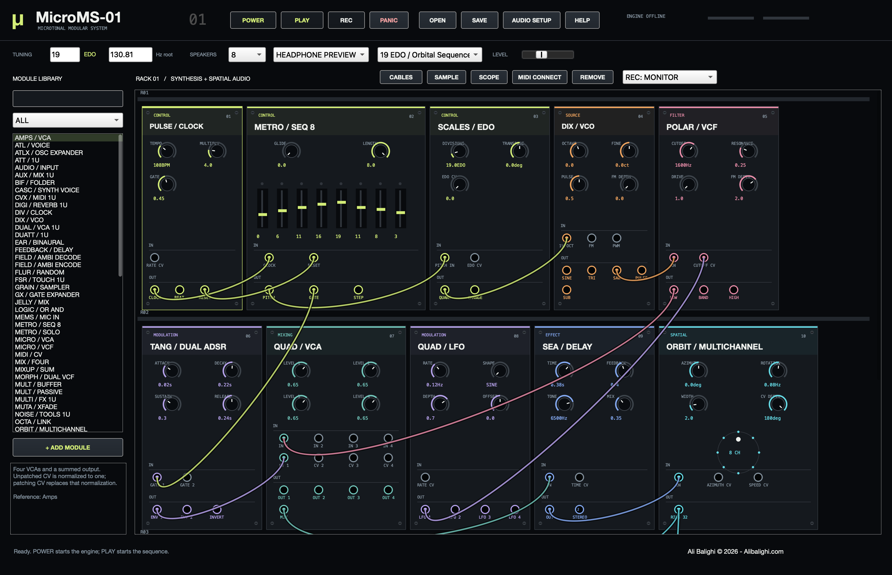

# MicroMS-01

**A native SuperCollider modular instrument by Ali Balighi.**  
**Ali Balighi © 2026 - Alibalighi.com**

[Listen to a rendered headphone preview](assets/MicroMS-01-demo.wav).

## Start

On this Mac, double-click **Launch MicroMS-01.command**. Keep the launcher alongside the project files. Alternatively, open **MicroMS-01.scd** in SuperCollider, select the whole document, and evaluate it with **Cmd+Return** (Ctrl+Return on Windows/Linux).

Press **POWER**, wait for “Engine ready”, then press **PLAY**. The initial **19 EDO / Orbital Sequence** patch is already connected. The second preset, **31 EDO / Glass Garden**, provides a slower FM texture.

The [50-preset factory bank](presets/README.md) adds leads, basses, FM keys, plucked strings, granular textures, ambient drones, percussion, generative music, polyrhythmic duets and spatial experiments. Choose them from the preset menu after restarting, or use OPEN to load a file from `presets/`. All play without external samples or MIDI. There are **52 saved patches** including the original two starters.

Requires the Qt build of **SuperCollider 3.14 or later**. Tested on macOS with SuperCollider 3.14.1. No Quarks, external UGen plugins, Python, web server, or browser are required to use the application. Windows/Linux users can run the `.scd` entry point; those platforms have not been tested.

## Make music

- Drag an output jack to an input, or click the two jacks in turn. Right-click a jack to disconnect it. Outputs may feed multiple inputs; a new connection replaces the previous cable at an input.
- Drag knobs vertically; hold **Shift** for fine adjustments. Double-click a knob to restore its default. Click a module header to select it.
- Drag sequence faders to edit EDO degrees; right-click a fader to toggle its gate. Click the gate sequencer's cells to edit rhythms. Drag the vector pad for X/Y control.
- Set any integer **EDO from 7 through 120**, and adjust the reference frequency in the top bar. Patch modulation into **SCALES / EDO → EDO CV** and turn its **EDO CV** amount up to modulate the number of equal divisions.
- Search the library and press Return, or choose a category. Select a result and click **+ ADD MODULE**. The library contains **81 selectable designs across 42 DSP families**.
- **OPEN / SAVE** use `.microms` JSON patches. **SAMPLE** loads up to three minutes of audio into the selected grain sampler. **MIDI CONNECT** connects available MIDI sources; patch MIDI pitch through SCALES to apply EDO quantization.
- **SCOPE** opens an oscilloscope for the selected module's first output. **PANIC** mutes the transport; **Cmd+Period** shuts down this application's engine. POWER starts it again.

## Spatial audio and recording

Choose **4, 8, 16, 24 or 32** active speaker channels. ORBIT distributes mono audio over a horizontal ring. FIELD provides **first-order AmbiX encoding and decoding**, EAR provides an **analytic headphone preview**, and STEREO provides a downmix.

The default patch connects ORBIT to the monitor ring input. The encoder, decoder and EAR comparison path are also connected. To audition EAR explicitly, disconnect the monitor's RING and AMBIX inputs and connect EAR's stereo output to the monitor's STEREO input. The monitor prioritizes a connected direct ring over decoding its AmbiX input during normal listening, so those two representations are not summed twice. **Raw AmbiX mode** outputs only the AmbiX input.

For actual loudspeakers, turn POWER off, open **AUDIO SETUP**, select the audio interface and configure enough hardware outputs, then select **PHYSICAL SPEAKERS**. Channel 1 is front; subsequent channels proceed toward the listener's left around the ring. Hardware channel counts must be supported by the chosen device.

**REC** writes floating-point WAV files into `recordings/`. **REC: MONITOR** records the chosen monitoring format. **REC: SELECTED OUT** records the selected module's first output directly: select ORBIT to export a speaker ring, or FIELD / AMBI ENCODE to export four-channel ACN/SN3D AmbiX. These exports work with a two-output interface. Stop recording before changing output format or loading another patch.

Headphone playback uses interaural delay and frequency-dependent head-shadow cues. It is an approximation, without measured or personalized HRTFs or head tracking. Stereo/headphones cannot exactly reproduce a physical multichannel room. The first-order Ambisonic representation has limited spatial resolution; horizontal rings do not reproduce elevation. Read [spatial conventions and limits](docs/SPATIAL-AUDIO.md).

## Module scope

The interface and musical functions are inspired by the supplied [Intellijel](https://intellijel.com/) and [Sweetwater](https://www.sweetwater.com/shop/keyboards-synthesizers/eurorack-modular-synthesizers/) catalogs. These are original SuperCollider instruments with hardware-style panels, not exact hardware/firmware emulations. Named variations share DSP families. This release does not contain every product in the Sweetwater catalog. Physical accessories and power/connector hardware have no literal DSP equivalents.

See the [complete module catalog and differences](docs/MODULES.md), [architecture](docs/ARCHITECTURE.md), and [validation notes](docs/VALIDATION.md).

## Files

- `MicroMS-01.scd`: application entry point.
- `lib/`: module catalog, DSP, routing engine, presets and native Qt interface.
- `presets/`: 50 factory patches, two starter patches and a bank guide.
- `recordings/`: your recordings.
- `assets/`: native interface preview and an offline-rendered audio example.
- `tests/`: compile, routing, persistence, native GUI, live engine and offline audio checks.

Closing the application window stops its own audio server. The launcher also closes its language process. Running the entry point inside the SuperCollider IDE leaves the IDE open. The application uses its own server on UDP port 57131 and does not change your SuperCollider startup files, Quarks or audio-device settings.
